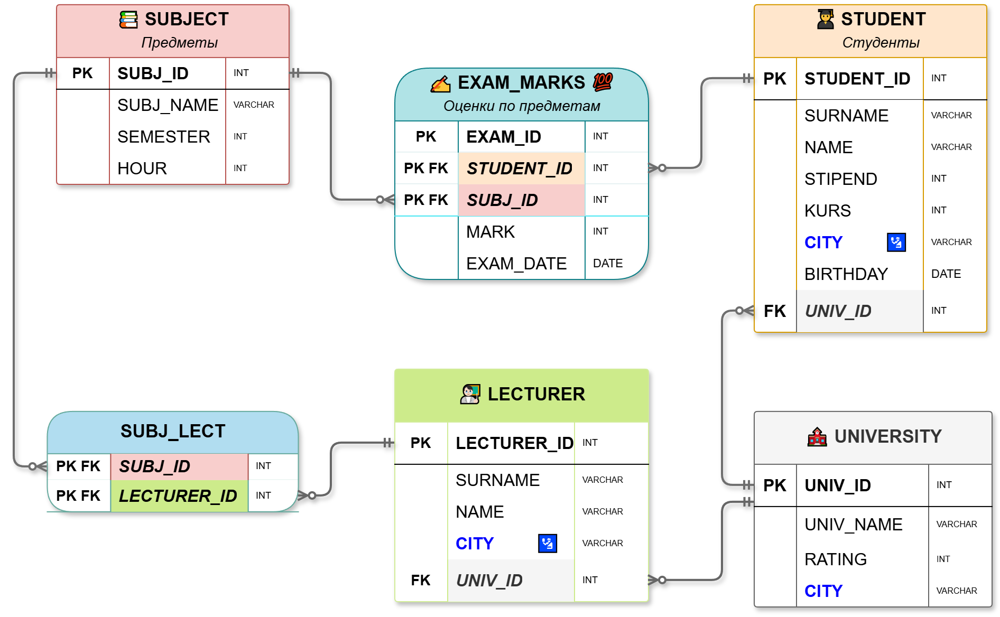

# 🗄️ Модели данных в базах данных: единая система классификации

> **Шпаргалка по проектированию БД на примере схемы «Университет»**

---

## 📌 Введение

В теории баз данных существует несколько классификаций моделей, которые описывают **один и тот же процесс проектирования** с разных сторон:

| Подход | Что классифицирует |
|---|---|
| 🏗️ **По этапам проектирования** | концептуальная → логическая → физическая |
| 🏛️ **По архитектуре ANSI/SPARC** | внешняя, обобщённая, внутренняя |
| 📚 **По отечественной терминологии** | инфологическая, датологическая |
| 🧮 **По математическому базису** | реляционная алгебра, теория графов |

Все примеры построены на конкретной схеме базы данных **«Университет»**.

---

## 🗂️ Исходная схема базы данных

В качестве сквозного примера используется следующая схема:



**Связи:**

 🔗 `lecturer.univ_id` → `university.univ_id` (один-ко-многим)
 🔗 `student.univ_id` → `university.univ_id` (один-ко-многим)
     🔗 `subject` → `student` (многие-ко-многим)
 🔗 `exam_marks.student_id` → `student.student_id` (один-ко-многим)
 🔗 `exam_marks.subj_id` → `subject.subj_id` (один-ко-многим)
     🔗 `subject` → `lecturer` (многие-ко-многим)
 🔗 `subj_lect.lecturer_id` → `lecturer.lecturer_id` (один-ко-многим)
 🔗 `subj_lect.subj_id` → `subject.subj_id` (один-ко-многим)

---

## 📊 Сводная таблица: единая система моделей данных

| Уровень / Этап | Название модели | Что описывает? | Главные элементы | От чего зависит? | Кто с ней работает? |
|---|---|---|---|---|---|
| **1. Бизнес-уровень** | **Концептуальная** (Инфологическая) | Суть бизнес-процессов реального мира без технических терминов | Сущности, связи, бизнес-правила | Не зависит ни от СУБД, ни от типа хранения | Бизнес-аналитики, заказчики, архитекторы |
| **2. Структурный уровень** | **Логическая** (Датологическая, Обобщённая) | Системную структуру данных для определённого класса баз | Таблицы, атрибуты, типы полей, ключи | Зависит от типа модели (SQL/NoSQL), но не от конкретной программы | Системные аналитики, разработчики БД |
| **3. Пользовательский уровень** | **Внешняя** | Взгляд на данные со стороны конкретной роли | Представления (Views), права доступа, интерфейсы | Зависит от бизнес-роли пользователя | Backend-разработчики, конечные пользователи |
| **4. Математический базис** | **Математическая** | Теоретический фундамент и правила обработки данных | Реляционная алгебра, теория множеств, логика предикатов | Чистая наука, заложенная в основу движка СУБД | Учёные (CS), создатели СУБД |
| **5. Технический уровень** | **Физическая** (Внутренняя) | То, как данные физически пишутся на накопители | SQL-скрипты, системные типы, индексы, файлы, сжатие | Жёстко привязана к конкретной СУБД и ОС | Администраторы БД (DBA), DevOps |

---

## 🔍 Подробный разбор на примере данной схемы

### 1️⃣ Концептуальная (инфологическая) модель

> 💡 **Что это:** Описание предметной области «Университет» на языке бизнеса. Никаких таблиц, ID и типов данных — только сущности и связи.

**Сущности:**

| Сущность | Описание |
|---|---|
| 🏛️ `Университет` | Учебное заведение с названием, рейтингом и городом |
| 👨‍🏫 `Преподаватель` | Сотрудник университета |
| 🎓 `Студент` | Обучающийся в университете |
| 📖 `Предмет` | Учебная дисциплина |
| 📝 `Экзаменационная оценка` | Факт сдачи экзамена |
| 👨‍🏫📖 `Преподавание` | Факт того, что преподаватель ведёт предмет |

**Связи:**

```
[Университет] ←──работает в── [Преподаватель]
[Университет] ←──учится в─── [Студент]
[Студент] ───сдаёт───────→ [Предмет] (атрибуты: оценка, дата)
[Преподаватель] ─ведёт────→ [Предмет]
```

**Бизнес-правила:**

- ✅ Студент может учиться только в одном университете
- ✅ Преподаватель может работать только в одном университете
- ✅ Оценка может быть только от 2 до 5
- ✅ Предмет может вести несколько преподавателей
- ✅ Преподаватель может вести несколько предметов

**Кто делает:** 👔 Бизнес-аналитик вместе с заказчиком (ректоратом)

**Инструмент:** 📐 ER-диаграмма (сущность-связь)

---

### 2️⃣ Логическая (датологическая) модель

> 💡 **Что это:** Превращение концептуальной модели в структуру, понятную реляционному классу СУБД. Появляются таблицы, атрибуты, ключи, типы данных — но без привязки к конкретному софту.

**Структура таблиц:**

```sql
university (univ_id PK, univ_name, rating, city)
lecturer (lecturer_id PK, surname, name, city, univ_id FK → university)
student (student_id PK, surname, name, stipend, kurs, city, birthday, univ_id FK → university)
subject (subj_id PK, subj_name, HOUR, semester)
exam_marks (exam_id, student_id, subj_id, mark, exam_date,
            PK(exam_id, student_id, subj_id))
subj_lect (lecturer_id, subj_id, PK(lecturer_id, subj_id))
```

**Первичные ключи:**

- 🔑 `university.univ_id`
- 🔑 `lecturer.lecturer_id`
- 🔑 `student.student_id`
- 🔑 `subject.subj_id`
- 🔑 `exam_marks` — составной `(exam_id, student_id, subj_id)`
- 🔑 `subj_lect` — составной `(lecturer_id, subj_id)`

**Внешние ключи:**

| Constraint | Откуда | Куда |
|---|---|---|
| `univlect_for_key` | `lecturer.univ_id` | `university.univ_id` |
| `univ_for_key` | `student.univ_id` | `university.univ_id` |
| `student_for_key` | `exam_marks.student_id` | `student.student_id` |
| `subject_for_key` | `exam_marks.subj_id` | `subject.subj_id` |
| `lect_for_key` | `subj_lect.lecturer_id` | `lecturer.lecturer_id` |
| `subj_for_key` | `subj_lect.subj_id` | `subject.subj_id` |

**Нормализация:**

- 📦 Данные об университетах вынесены в `university`
- 📦 Данные о предметах вынесены в `subject`
- 📦 Оценки вынесены в `exam_marks` (многие-ко-многим)
- 📦 Связь преподавателей и предметов — в `subj_lect` (многие-ко-многим)

**Кто делает:** 🧑‍💻 Системный аналитик, архитектор данных

**Аналог:** Датологическая = Обобщённая (ANSI/SPARC)

---

### 3️⃣ Физическая (внутренняя) модель

> 💡 **Что это:** Реализация логической модели в конкретной СУБД (PostgreSQL) с учётом технических особенностей: системные типы, индексы, партиционирование.

```sql
-- 🏛️ Университеты
CREATE TABLE university (
    univ_id     SERIAL PRIMARY KEY,
    univ_name   VARCHAR(160) NOT NULL,
    rating      INTEGER CHECK (rating BETWEEN 0 AND 100),
    city        VARCHAR(60)
);

-- 👨‍🏫 Преподаватели
CREATE TABLE lecturer (
    lecturer_id SERIAL PRIMARY KEY,
    surname     VARCHAR(60) NOT NULL,
    name        VARCHAR(60) NOT NULL,
    city        VARCHAR(60),
    univ_id     INTEGER REFERENCES university(univ_id)
);

-- 🎓 Студенты
CREATE TABLE student (
    student_id  BIGSERIAL PRIMARY KEY,
    surname     VARCHAR(60) NOT NULL,
    name        VARCHAR(60) NOT NULL,
    stipend     INTEGER CHECK (stipend >= 0),
    kurs        SMALLINT CHECK (kurs BETWEEN 1 AND 6),
    city        VARCHAR(60),
    birthday    DATE,
    univ_id     INTEGER REFERENCES university(univ_id)
);

-- 📖 Предметы
CREATE TABLE subject (
    subj_id     SERIAL PRIMARY KEY,
    subj_name   VARCHAR(60) NOT NULL,
    hour        INTEGER CHECK (hour > 0),
    semester    SMALLINT CHECK (semester BETWEEN 1 AND 12)
);

-- 📝 Оценки
CREATE TABLE exam_marks (
    exam_id     INTEGER NOT NULL,
    student_id  BIGINT NOT NULL REFERENCES student(student_id),
    subj_id     INTEGER NOT NULL REFERENCES subject(subj_id),
    mark        INTEGER CHECK (mark BETWEEN 2 AND 5),
    exam_date   DATE DEFAULT CURRENT_DATE,
    PRIMARY KEY (exam_id, student_id, subj_id)
);

-- 👨‍🏫📖 Преподавание
CREATE TABLE subj_lect (
    lecturer_id INTEGER NOT NULL REFERENCES lecturer(lecturer_id),
    subj_id     INTEGER NOT NULL REFERENCES subject(subj_id),
    PRIMARY KEY (lecturer_id, subj_id)
);

-- ⚡ Индексы
CREATE INDEX student_id_1       ON exam_marks (student_id);
CREATE INDEX idx_exam_subj      ON exam_marks (subj_id);
CREATE INDEX idx_exam_date      ON exam_marks (exam_date);
CREATE INDEX idx_student_univ   ON student (univ_id);
CREATE INDEX idx_lecturer_univ  ON lecturer (univ_id);
CREATE INDEX idx_student_surn   ON student (surname);
CREATE INDEX idx_lecturer_surn  ON lecturer (surname);

-- 📅 Партиционирование по году экзамена
CREATE TABLE exam_marks_2024 PARTITION OF exam_marks
    FOR VALUES FROM ('2024-01-01') TO ('2025-01-01');
CREATE TABLE exam_marks_2025 PARTITION OF exam_marks
    FOR VALUES FROM ('2025-01-01') TO ('2026-01-01');
```

**Технические детали:**

| Элемент | Значение |
|---|---|
| 🧬 **Системные типы** | `SERIAL`, `BIGSERIAL`, `VARCHAR`, `INTEGER`, `SMALLINT`, `DATE` |
| ⚡ **Индексы** | B-Tree по `student_id`, `subj_id`, `exam_date`, `univ_id`, `surname` |
| 📅 **Партиционирование** | `exam_marks` по годам экзамена |
| 🔒 **Ограничения** | `CHECK` на оценку (2–5), курс (1–6), семестр (1–12), рейтинг (0–100) |

**Кто делает:** 🛠️ DBA, DevOps-инженер

**Аналог:** Внутренняя модель (ANSI/SPARC)

---

### 4️⃣ Внешняя модель (пользовательский уровень)

> 💡 **Что это:** Представление данных для конкретной роли. Одна и та же схема выглядит по-разному для ректората, преподавателя и студента.

| Роль | Что видит | Как реализуется |
|---|---|---|
| 🏛️ **Ректорат** | Все университеты, студентов, преподавателей, оценки | `SELECT * FROM ... JOIN ...` |
| 👨‍🏫 **Преподаватель** | Только свои предметы и оценки студентов | `VIEW teacher_view` |
| 🎓 **Студент** | Только свои данные и оценки | `VIEW student_view` |

**👁️ View для студента:**

```sql
CREATE VIEW student_view AS
SELECT
    s.surname, s.name,
    sub.subj_name, sub.semester,
    e.mark, e.exam_date,
    l.surname AS lecturer_surname,
    l.name AS lecturer_name
FROM student s
JOIN exam_marks e ON s.student_id = e.student_id
JOIN subject sub ON e.subj_id = sub.subj_id
LEFT JOIN subj_lect sl ON sub.subj_id = sl.subj_id
LEFT JOIN lecturer l ON sl.lecturer_id = l.lecturer_id
WHERE s.student_id = CURRENT_USER;
```

**👁️ View для преподавателя:**

```sql
CREATE VIEW teacher_view AS
SELECT
    s.surname AS student_surname,
    s.name AS student_name,
    s.kurs,
    sub.subj_name,
    e.mark,
    e.exam_date
FROM exam_marks e
JOIN student s ON e.student_id = s.student_id
JOIN subject sub ON e.subj_id = sub.subj_id
JOIN subj_lect sl ON sub.subj_id = sl.subj_id
WHERE sl.lecturer_id = CURRENT_USER;
```

**👁️ View для ректората:**

```sql
CREATE VIEW rectorate_view AS
SELECT
    u.univ_name, u.rating, u.city,
    COUNT(DISTINCT s.student_id)  AS student_count,
    COUNT(DISTINCT l.lecturer_id) AS lecturer_count,
    AVG(e.mark)                   AS avg_mark
FROM university u
LEFT JOIN student s     ON u.univ_id = s.univ_id
LEFT JOIN lecturer l    ON u.univ_id = l.univ_id
LEFT JOIN exam_marks e  ON s.student_id = e.student_id
GROUP BY u.univ_id, u.univ_name, u.rating, u.city;
```

**Кто делает:** 💻 Backend-разработчик, администратор прав доступа

**Аналог:** Внешняя модель (ANSI/SPARC)

---

### 5️⃣ Математическая модель

> 💡 **Что это:** Теоретический фундамент, на котором строится СУБД. Для данной реляционной схемы — реляционная алгебра и реляционное исчисление.

**Основные операции:**

| Операция | Обозначение | Пример для данной схемы |
|---|---|---|
| Проекция | `π` | `π_{surname, name}(student)` |
| Селекция | `σ` | `σ_{kurs = 3}(student)` |
| Соединение | `⋈` | `student ⋈ exam_marks` |
| Объединение | `∪` | студенты, сдавшие математику ∪ физику |
| Пересечение | `∩` | студенты, сдавшие и математику, и физику |
| Разность | `−` | студенты, сдавшие математику, но не физику |

**Пример запроса:**

> «Найти фамилии студентов 3-го курса, сдавших математику на 5»

```
π_{surname}(
    σ_{kurs = 3 ∧ subj_name = 'Математика' ∧ mark = 5}(
        student ⋈ exam_marks ⋈ subject
    )
)
```

**Пример запроса:**

> «Найти всех преподавателей, которые ведут предметы у студентов 3-го курса»

```
π_{surname, name}(
    lecturer ⋈ subj_lect ⋈ subject ⋈ exam_marks ⋈ σ_{kurs = 3}(student)
)
```

**Кто делает:** 🔬 Учёные в области Computer Science, создатели СУБД (Эдгар Кодд)

---

## 🔄 Как всё связано: сквозной пример

Проследим путь от идеи до файлов на диске:

```
1️⃣ БИЗНЕС-АНАЛИТИК
   └─→ Концептуальная модель: ER-диаграмма
       «Студент учится в университете, преподаватель работает в университете,
        студент сдаёт предмет с оценкой, преподаватель ведёт предмет»

2️⃣ СИСТЕМНЫЙ АНАЛИТИК
   └─→ Логическая модель: таблицы university, lecturer, student,
       subject, exam_marks, subj_lect

3️⃣ МАТЕМАТИЧЕСКАЯ МОДЕЛЬ
   └─→ Реляционная алгебра гарантирует корректность запросов

4️⃣ DBA
   └─→ Физическая модель: SQL-скрипты с SERIAL, BIGSERIAL,
       индексами, партиционированием

5️⃣ BACKEND-РАЗРАБОТЧИК
   └─→ Внешние модели: студент видит свои оценки,
       преподаватель — свою дисциплину, ректорат — сводку
```

---

## 📋 Шпаргалка: соответствие терминов

| Этап проектирования | Отечественная терминология | ANSI/SPARC | Пример для данной схемы |
|---|---|---|---|
| Концептуальная | Инфологическая | — (чистый бизнес) | ER-диаграмма: Университет → Студент, Преподаватель → Предмет |
| Логическая | Датологическая | Обобщённая | Таблицы `university`, `student`, `lecturer`, `subject`, `exam_marks`, `subj_lect` |
| — | — | Внешняя | View для студента / преподавателя / ректората |
| Физическая | — | Внутренняя | SQL-скрипт с индексами и партициями |
| Математическая | — | — | Реляционная алгебра, теория множеств |

---

## 🎯 Заключение

Все классификации описывают **один и тот же процесс** с разных сторон:

| Подход | Что показывает |
|---|---|
| 🏗️ **По этапам проектирования** | Что делаем (бизнес → структура → код) |
| 🏛️ **По ANSI/SPARC** | Где это живёт (обобщённая / внешняя / внутренняя) |
| 📚 **По отечественной школе** | Инфологическая / датологическая |
| 🧮 **По математике** | На чём всё держится (теория множеств, графы) |

> 💡 **Используйте эту шпаргалку**, чтобы не путаться в терминах и видеть целостную картину проектирования баз данных на примере схемы **«Университет»**.

